# Créer un devoir ou un examen dans CodEval

Ce guide montre comment saisir trois sujets papier dans CodEval :

| Sujet | Classe | Exercices |
|---|---|---|
| Devoir commun **Initiation algorithmique** (30/11/2024, 2 h) | SRIT1 | simulation d'algorithme, 3 algorithmes à écrire |
| Devoir surveillé **C avancé** (27/02/2024, 2 h) | M1 MBDS | questions de cours, approche modulaire rédigée |
| Examen 2ᵉ session **C avancé** (mars 2025, 2 h) | M1 MBDS, BIHAR, SIGL | projet C en 5 fichiers lancé avec un argument, commandes de compilation, QCM |

Chaque type d'exercice n'est montré qu'une fois. Pour les exercices du même type, le guide donne seulement ce qui change.

Les captures viennent d'un compte de démonstration (« Prof Démo »). Les trois épreuves y sont enregistrées en brouillon, prêtes à servir de modèle.

---

## Correspondance entre les sujets et les types CodEval

| Exercice du sujet | Type CodEval | Correction |
|---|---|---|
| Algo, ex. 1 : simulation de `CalculDeMoyenne` | **Simulation** (nouveau) | automatique, case par case |
| Algo, ex. 2, 3, 4 : écrire un algorithme | **Algorithmique** (blocs) | automatique, par jeux de tests |
| C, devoir, ex. 1 : questions de cours | **Question-réponse** | mots-clés ou correction manuelle |
| C, devoir, ex. 2 : approche modulaire d'une gestion de stock | **Question-réponse** (réponse longue) | manuelle |
| C, examen, ex. 1 et 2.1 : `Etudiant.h`, `Note.h`, `Fonctions.h`, `Fonctions.c`, `main.c` | **Code**, plusieurs fichiers | automatique : déclarations et programme lancé avec `40` en argument |
| C, examen, ex. 2.2 : commandes de compilation | **Question-réponse** (mots-clés) | automatique |
| C, examen, ex. 3 : 5 questions à choix unique | **QCM** | automatique |

> **Ce qui manquait et a été ajouté.** Jusqu'ici, CodEval n'avait pas de tableau de simulation : il fallait transformer l'exercice 1 d'algorithmique en questions. Et un test ne passait que si l'étudiant écrivait exactement les messages prévus par l'enseignant (« Entrez le nombre numéro 1 : »…). Deux ajouts règlent ces deux points :
>
> - le type d'exercice **Simulation** (§3.1) ;
> - le mode de comparaison **Nombres affichés** (§3.2) : la correction ne regarde que les derniers nombres affichés, et l'étudiant écrit les messages qu'il veut.

---

## 1. Avant de commencer

Il faut d'abord une **matière** (menu *Mes matières*), car c'est elle qui fixe le langage :

- *Initiation algorithmique* : langage **Algorithmique** (pseudo-code en blocs) ;
- *C avancé* : langage **C**.

Il faut aussi une **classe** (menu *Mes classes*). Les étudiants la rejoignent avec son code.

## 2. Créer l'épreuve : étape « Paramètres »

Allez dans *Créer une évaluation* et remplissez :

| Champ | Devoir algo | Devoir C | Examen C |
|---|---|---|---|
| Titre | Devoir commun — Initiation algorithmique | Devoir surveillé — C avancé | Examen 2e session — C avancé |
| Type | Devoir | Devoir | Examen |
| Classe / Matière | SRIT1 A / Initiation algorithmique | M1 MBDS / C avancé | M1 MBDS / C avancé |
| Durée | 2h (bouton *2h*) | 2h | 2h |
| Barème total | 20 | 20 | 20 |

Mettez l'en-tête du sujet (ECUE, parcours, année) et le bloc « Important à lire » dans les **consignes**, en bas de la page. L'étudiant les lit avant de commencer :

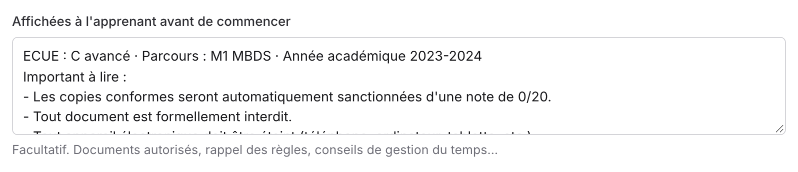

> **« 1 pt pour la propreté de la copie »** (devoir de C) : cette consigne n'a pas d'équivalent pour une copie tapée. Pour l'appliquer quand même, gardez des exercices sur 20 et ajoutez le point à la main sur la copie, avec *Modifier la note de cet exercice*. Chaque ajustement est enregistré avec son motif.

Cliquez sur **Enregistrer et continuer →**.

## 3. Ajouter les exercices : étape « Exercices »

Cliquez sur **+ Ajouter un exercice**, puis choisissez le type :

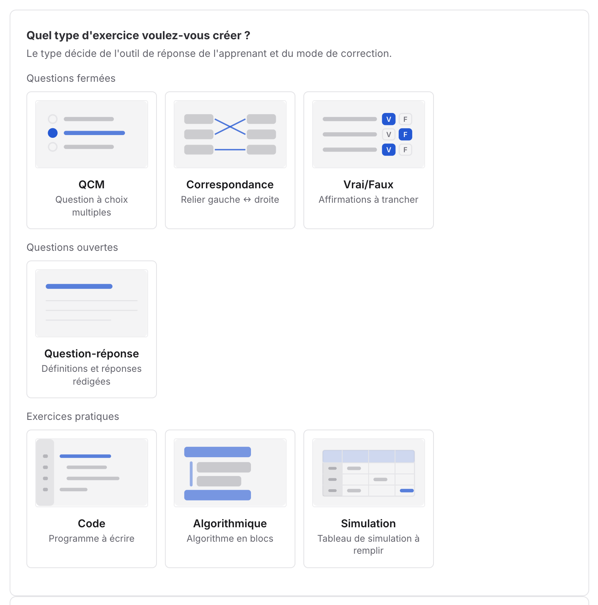

Un aperçu du sujet, tel que l'étudiant le verra, se met à jour à droite pendant que vous écrivez.

### 3.1 Simulation d'algorithme (devoir d'algo, exercice 1)

Type **Simulation**.

1. **Intitulé** et **énoncé** : « Faire la simulation de l'algorithme ci-dessous pour laquelle l'utilisateur a saisi 10, 11 et 12. »
2. **Algorithme à simuler** : collez l'algorithme du sujet, avec ses numéros de ligne. Il s'affiche en police fixe et coloré sur la feuille de l'étudiant.
3. **Tableau de simulation attendu** : une colonne par variable, une colonne *Condition* et une colonne *Écran*, puis une ligne par instruction exécutée. Remplissez-le comme vous le corrigeriez sur papier.

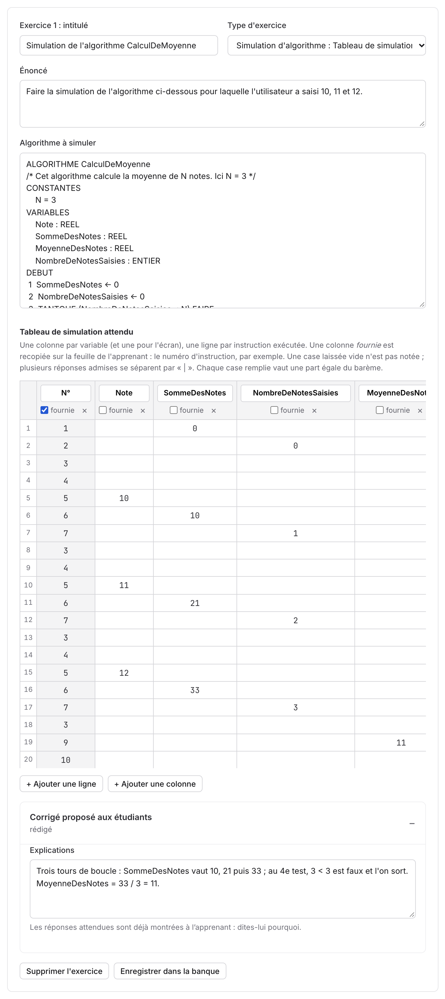

La partie droite du tableau, avec la condition du `TANTQUE` et l'affichage :

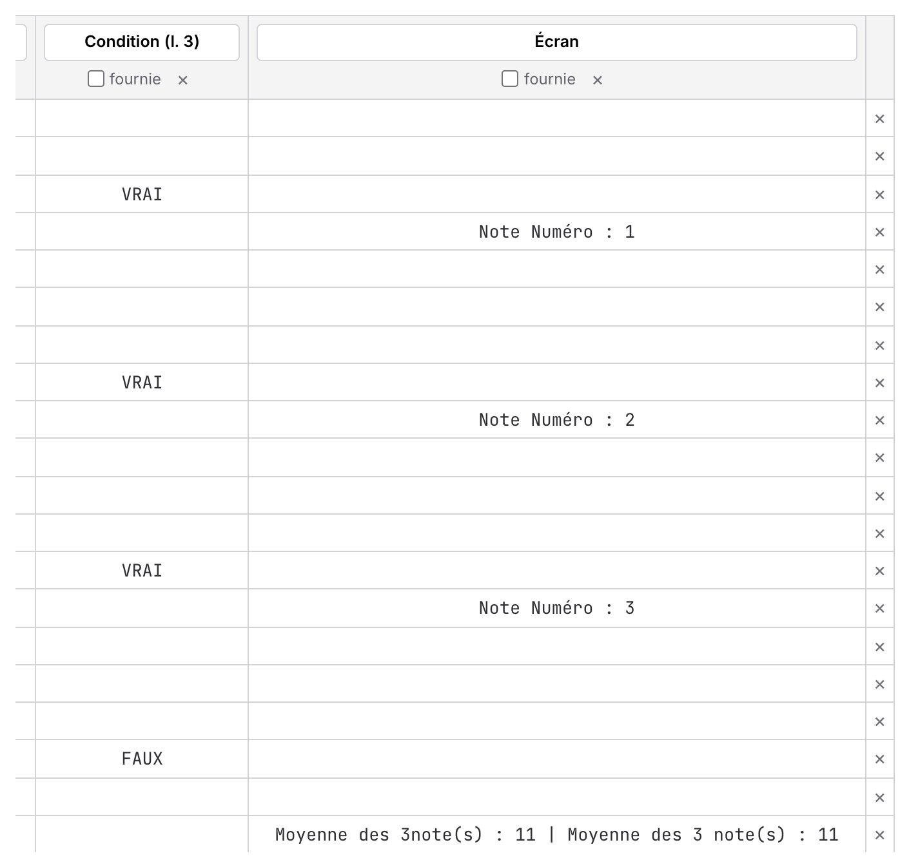

Règles de correction :

- **Colonne fournie** (case cochée) : elle est déjà remplie sur la feuille de l'étudiant. Ici, c'est le numéro d'instruction (1, 2, 3, 4, 5, 6, 7, 3, 4…). Décochez-la si l'étudiant doit retrouver lui-même l'ordre d'exécution : elle sera alors notée elle aussi.
- **Une case laissée vide n'est pas notée.** L'étudiant peut recopier la valeur d'une variable qui ne change pas, ou laisser la case vide : les deux sont acceptés.
- Chaque case remplie vaut une part égale du barème. Ici, 20 cases pour 5 points, soit 0,25 point par case.
- Les nombres se comparent par leur valeur : `10`, `10,0` et `10.00` sont équivalents. Le texte se compare sans tenir compte des majuscules, des accents ni de la ponctuation : `vrai` = `VRAI`, `Note numero 1` = `Note Numéro : 1`.
- Plusieurs réponses admises : séparez-les par `|`. Exemple : `Moyenne des 3note(s) : 11 | Moyenne des 3 note(s) : 11`.

L'aperçu à droite montre le tableau vide que l'étudiant recevra :

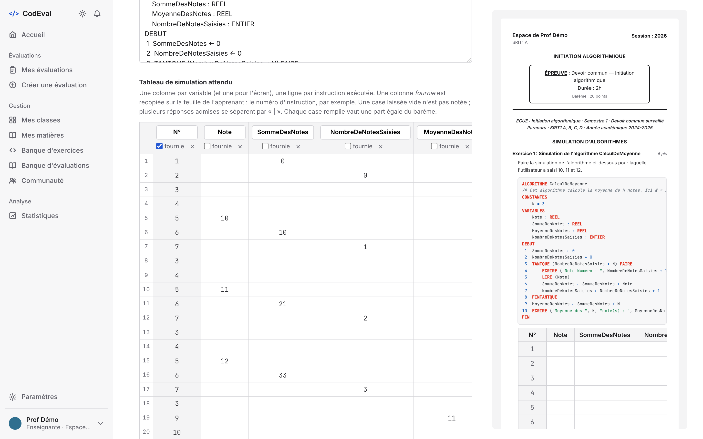

### 3.2 Algorithme à écrire (devoir d'algo, exercices 2, 3 et 4)

Type **Algorithmique**. Exemple de l'exercice 4 : recopiez l'énoncé, y compris l'exemple d'exécution, puis choisissez les **outils autorisés** (LIRE, ECRIRE, SI, TANTQUE…).

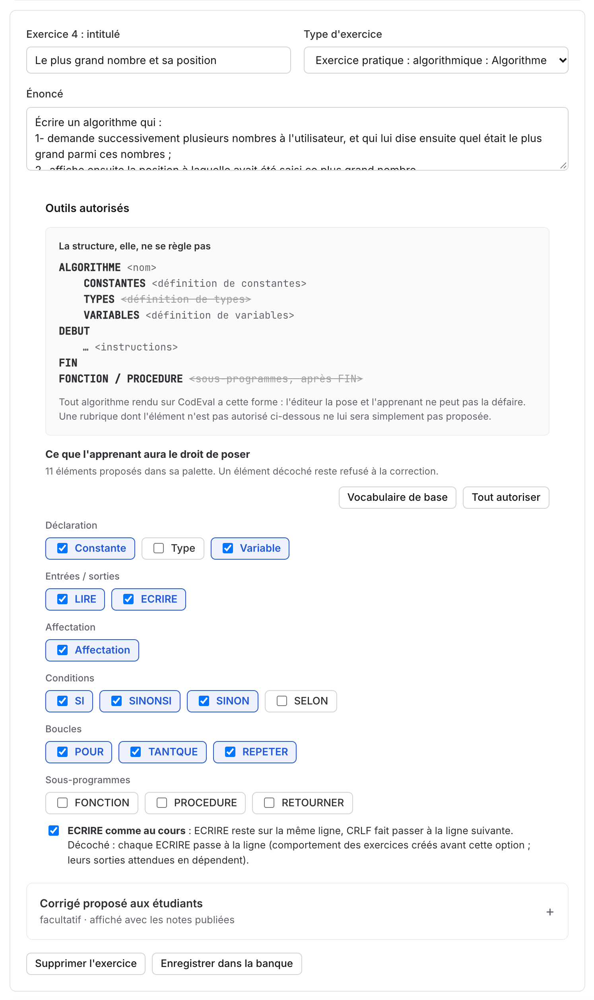

Les jeux de tests se règlent à l'**étape 3 « Correction »**. Choisissez l'exercice dans la colonne de gauche, puis ajoutez des tests :

Dans chaque test :

- **Les valeurs envoyées au programme** : ce que l'étudiant « tape », dans l'ordre.
- **Ce qui doit être affiché** : avec la comparaison **Nombres affichés**, écrivez seulement les nombres attendus en fin de sortie, ici `15 3`. Les invites (« Entrez le nombre numéro 1 : ») et les phrases de l'étudiant sont ignorées. `Le plus grand est : 15 / C'était le n° 3` est donc accepté.

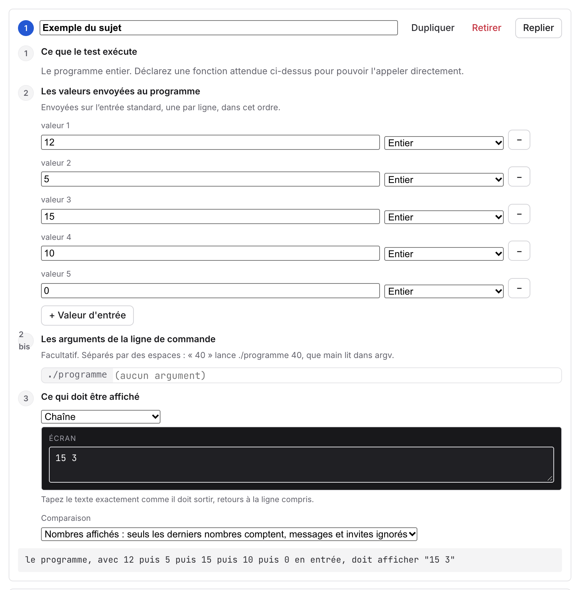

Les tests utilisés pour les trois exercices :

| Exercice | Valeurs envoyées | Attendu (Nombres affichés) |
|---|---|---|
| 2. Les dix nombres suivants | `17` / `-3` / `0` | `18 19 … 27` / `-2 -1 … 7` / `1 2 … 10` |
| 3. Tarif plein ou réduit | `mercredi 30 NON` / `lundi 30 OUI` / `samedi 12 NON` / `mardi 70 NON` / `dimanche 30 NON` | `4.5` / `4.5` / `7` / `4.5` / `7` |
| 4. Le plus grand et sa position | `12 5 15 10 0` / `3 1 2 0` / `-5 -2 -9 0` | `15 3` / `3 1` / `-2 2` |

> **Exercice 3 : précisez l'ordre de saisie dans l'énoncé.** Par exemple : « Données à saisir, dans cet ordre : le jour, l'âge, puis OUI ou NON ». Les tests envoient les valeurs dans un ordre fixe, l'étudiant doit donc les lire dans le même ordre. C'est la seule précision à ajouter au sujet : les messages restent libres.

Le mode *Souple* (texte exact, espaces de fin ignorés) reste utile pour un affichage imposé. Le mode *Numérique* convient quand la sortie ne contient que des nombres.

### 3.3 Questions de cours (devoir de C, exercice 1)

Type **Question-réponse**. Ajoutez une question par point du sujet avec **+ Ajouter une question**. Le 2.a et le 2.b deviennent deux questions séparées. Le barème de l'exercice se partage également entre les questions.

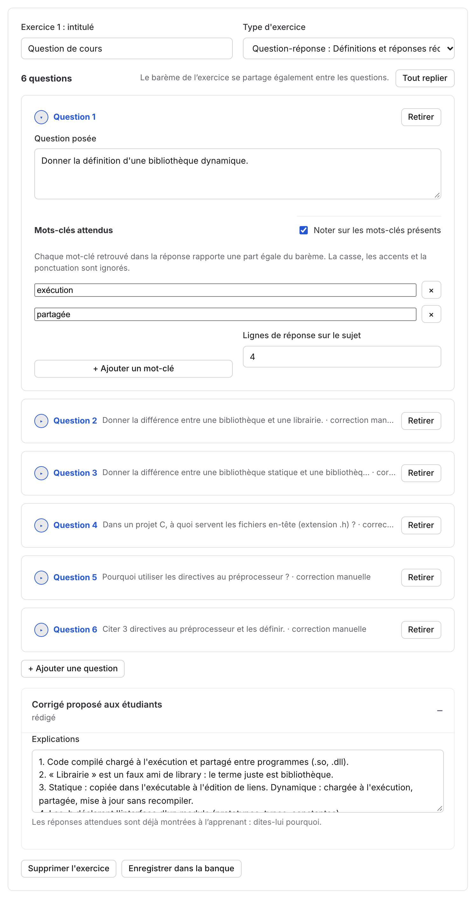

Pour chaque question, trois possibilités :

- **aucune réponse listée** : la question vous sera signalée pour une **correction manuelle** (questions 2 à 6 ci-dessus) ;
- **formulations acceptées** : la réponse doit correspondre à l'une d'elles ;
- **Noter sur les mots-clés présents** : chaque mot-clé retrouvé dans la réponse rapporte sa part. Pour la question 1 : `exécution`, `partagée`.

*Lignes de réponse sur le sujet* règle la place laissée sur la version imprimée.

**Exercice 2 (gestion d'un stock)** : même type. Une seule question, *Lignes de réponse* à 12, aucune réponse listée : la correction est manuelle. Mettez la démarche attendue dans le **Corrigé proposé aux étudiants** (*Explications*). Si vous voulez plutôt une réponse en code, créez un exercice **Code** à plusieurs fichiers (`produit.h`, `stock.h`, `stock.c`, `main.c`), comme au §3.4.

### 3.4 Projet C en plusieurs fichiers (examen, exercices 1 et 2.1)

Type **Code**. Les exercices 1 et 2.1 portent sur **le même programme**. On les réunit donc dans un seul exercice de 12 points (8 + 4), pour que l'étudiant écrive son `main.c` à côté de ses en-têtes.

1. **Énoncé** : le texte commun du sujet (structures, fonctions, les 5 fichiers, les bouts de code d'aide), puis les deux questions. Ajoutez ce que la correction automatique doit connaître : les signatures exactes, le nombre d'étudiants lu dans `argv[1]`, une ligne « matricule nom note » par étudiant.
2. **Fichiers du projet** : choisissez *Plusieurs fichiers*, puis déclarez `Etudiant.h`, `Note.h`, `Fonctions.h`, `Fonctions.c`, `main.c`. L'étudiant aura un onglet par fichier.

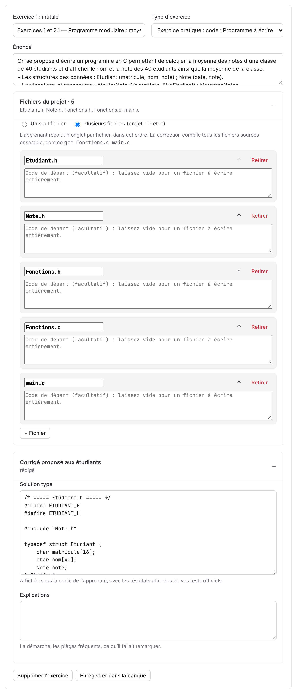

À l'étape **Correction** :

- **Ce que le code doit contenir** : les structures `Note` et `Etudiant`, et les trois fonctions avec leur signature. La correction les cherche dans tous les fichiers du projet. Pour un type défini dans le projet, choisissez *Autre type* et écrivez-le comme en C : `Note`, `Etudiant *`.

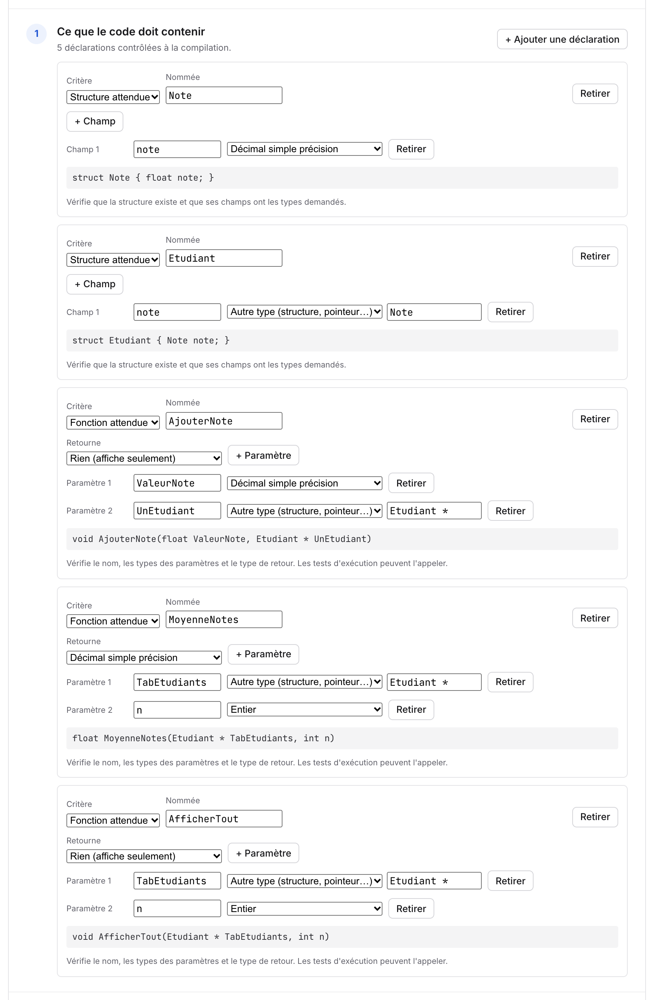

- **Jeux de tests** : le programme entier, compilé avec tous les fichiers. **Les arguments de la ligne de commande** remplacent le `40` de `ProgrammeMoyenne.exe 40` : avec `3`, le programme reçoit 3 étudiants. Avec la comparaison *Nombres affichés*, le test ne vérifie que la moyenne, dernière valeur affichée. La présentation de la liste des étudiants reste libre.

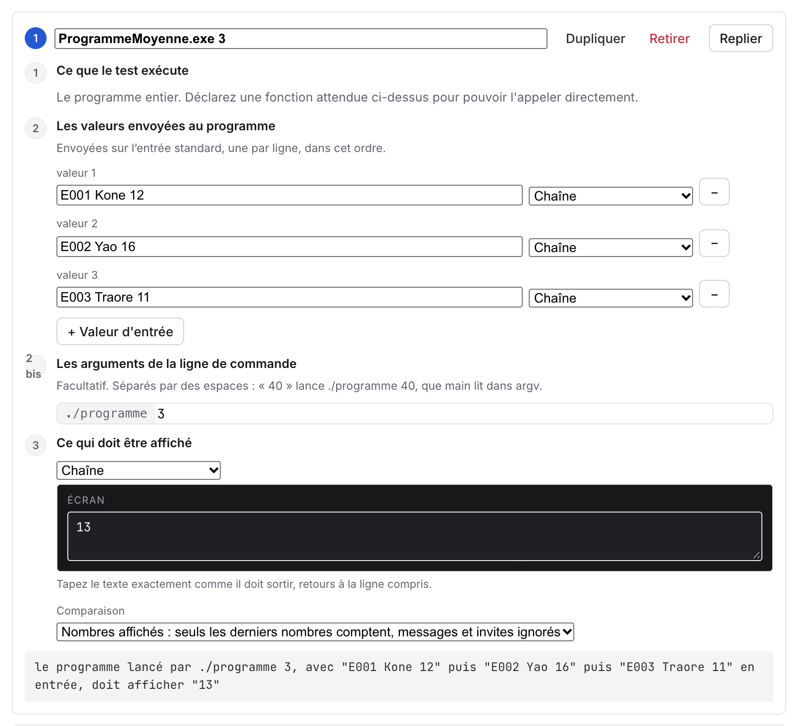

À l'étape 4, le bouton **Détail du barème** répartit les 12 points entre déclarations et tests. Le modèle utilise 6 points de déclarations (en-têtes) et 6 points de tests (`Fonctions.c` et `main.c`).

### 3.5 Commandes de compilation (examen, exercice 2.2)

Type **Question-réponse**, comme au §3.3, avec **Noter sur les mots-clés présents** : `Fonctions.c`, `main.c`, `Fonctions.o`, `-o ProgrammeMoyenne.exe`. Une réponse qui compile séparément puis fait l'édition de liens obtient 3/3. Une compilation en une seule commande (`gcc Fonctions.c main.c -o ProgrammeMoyenne.exe`) obtient 2,25/3, car il manque le fichier objet.

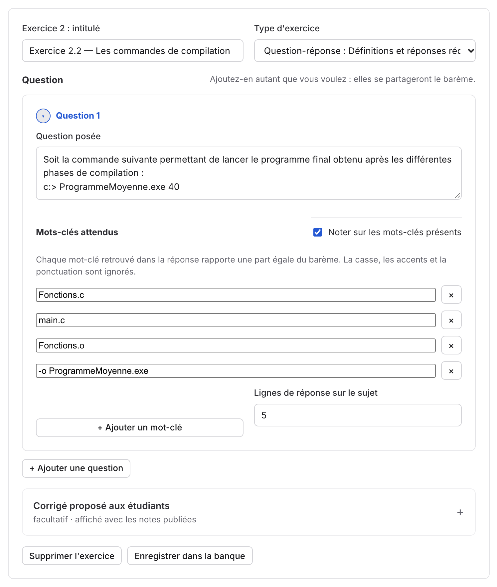

### 3.6 QCM (examen, exercice 3)

Type **QCM**. Ajoutez une question par item, saisissez les 4 propositions et cochez la bonne réponse. Les propositions apparaissent à l'étudiant dans un ordre mélangé. Dans le sujet PDF, les propositions b) et c) de la question 5 sont collées sur une même ligne : séparez-les en deux choix.

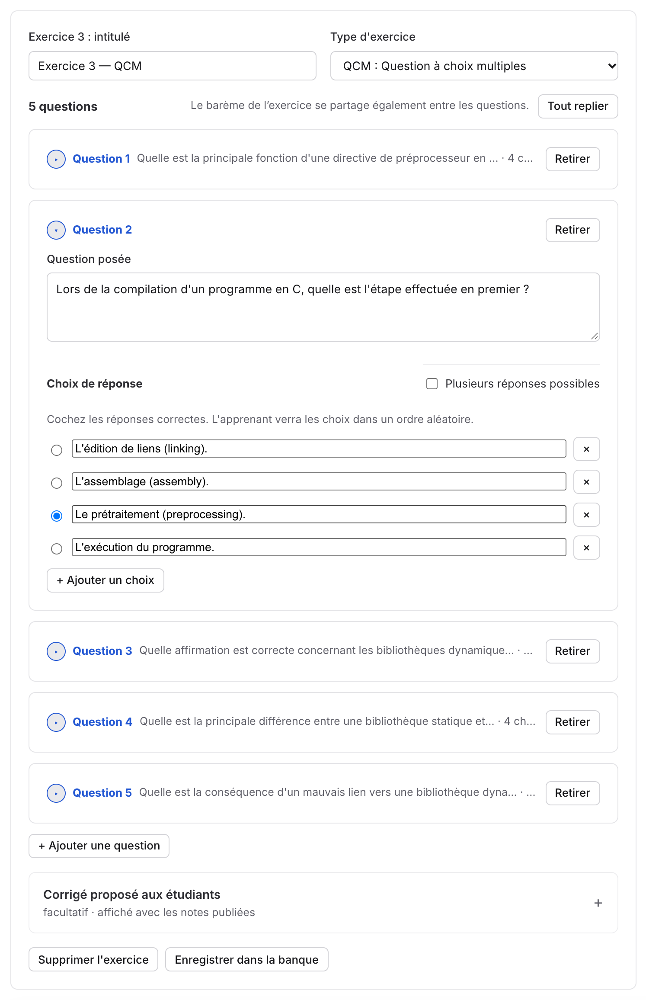

## 4. Points et publication

À l'étape 4, vérifiez la valeur de chaque exercice. Le total doit faire 20.

| Épreuve | Répartition |
|---|---|
| Devoir algo | 5 + 5 + 4 + 6 |
| Devoir C | 10 + 10 |
| Examen C | 12 (ex. 1 et 2.1) + 3 (ex. 2.2) + 5 (QCM) |

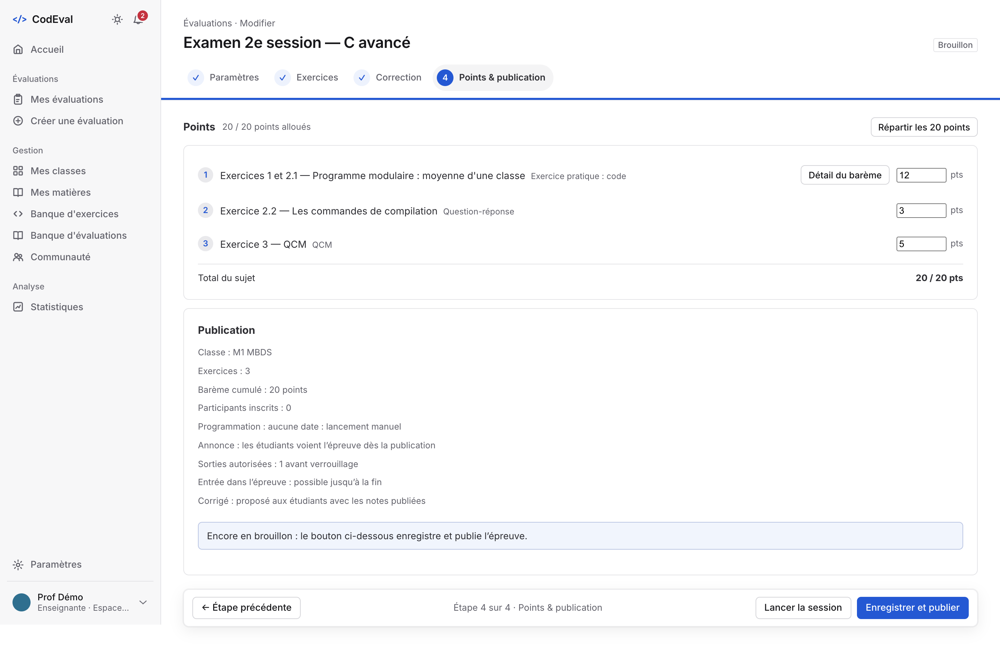

**Enregistrer et publier** rend l'épreuve visible pour la classe. Avec une date d'ouverture, le bouton devient *Enregistrer et programmer*. **Lancer la session** l'ouvre tout de suite.

## 5. Côté étudiant, puis correction

Pendant l'épreuve, l'étudiant lit l'algorithme à gauche et remplit le tableau à droite. La touche Entrée passe à la ligne suivante, dans la même colonne. Son travail est sauvegardé sur le poste puis envoyé au serveur.

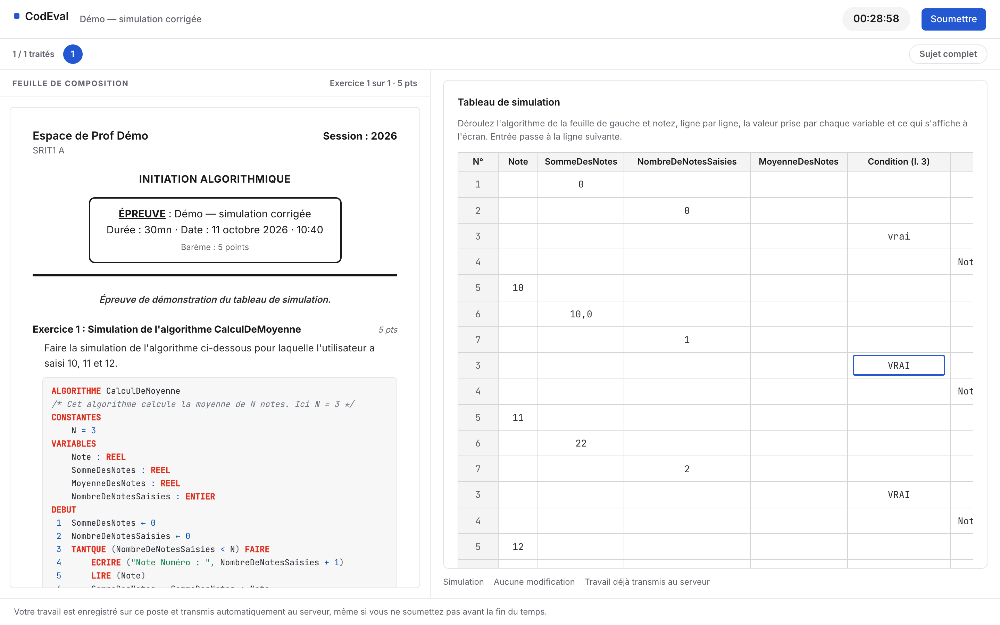

Après la clôture, lancez la correction. Sur la copie, chaque case notée est verte ou rouge, avec la valeur attendue sous une erreur. Ici : 18 cases justes sur 20, soit 4,5/5. `10,0` et `vrai` sont acceptés, `22` (au lieu de 21) et `Moyenne : 11` sont refusés.

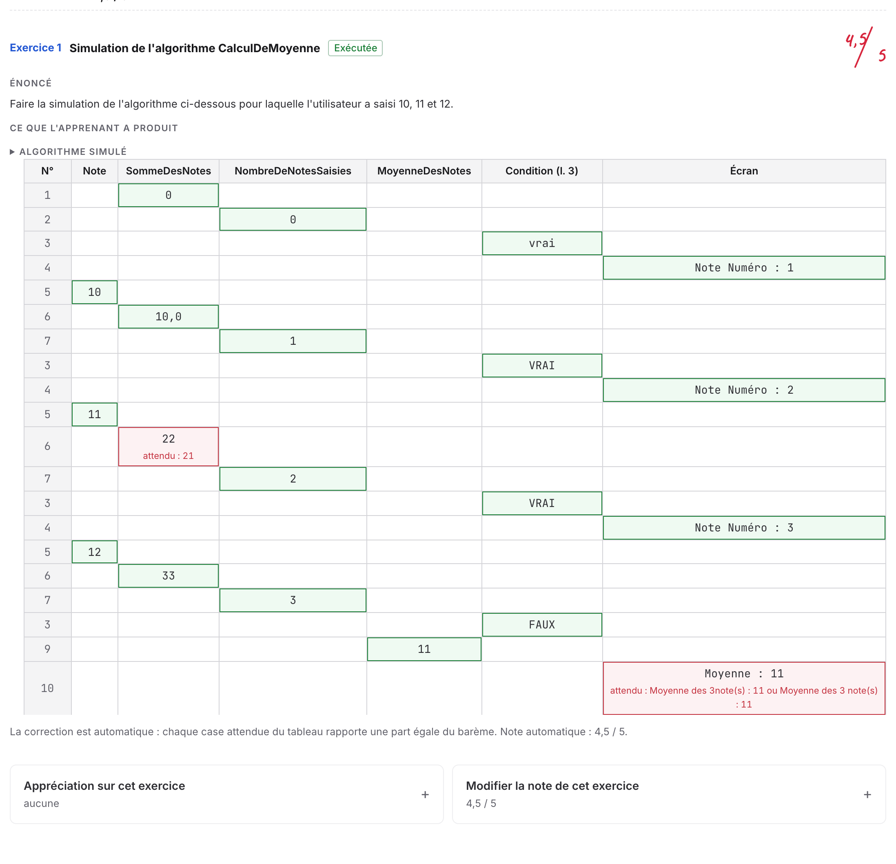

Une fois les résultats publiés, l'étudiant voit la même copie annotée, avec le corrigé à déplier :

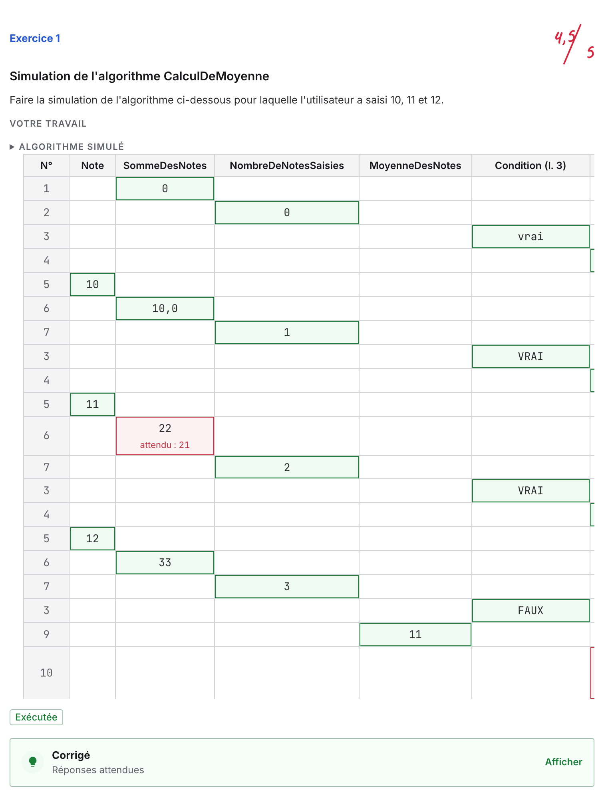

La note reste modifiable à la main sur chaque exercice (*Modifier la note de cet exercice*). C'est utile pour une question corrigée manuellement ou pour le point de propreté.
